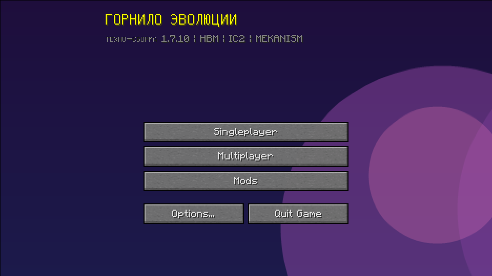

# 🔥 Горнило Эволюции — BETA 0.01v

**Техно-модпак для Minecraft 1.7.10 (Forge 10.13.4.1614)** — одна большая экосистема: от кремня до звёзд.
Ядро — **HBM's Nuclear Tech**, плюс **Advanced Rocketry**, IC2 + IndustrialUpgrade, Mekanism, AE2, EnderIO,
Thermal-серия, ProjectE и ещё ~50 модов. Без магии. Единая энергия EU, унифицированные руды, кастомное меню.

> ⚠️ **BETA 0.01v** — сборка в активной разработке. Состав модов будет меняться.



---

## 🚀 Быстрый старт (как из коробки)

**Требования:** Windows, **Java 8** (обязательно), 4+ ГБ RAM, Minecraft Forge **1.7.10-10.13.4.1614**.

### Вариант A — лаунчер из репозитория (рекомендуется)

1. Установи ваниль 1.7.10 и **Forge 1.7.10-10.13.4.1614** (через TLauncher / официальный лаунчер).
2. Склонируй репозиторий:
   ```bat
   git clone https://github.com/Jabanz/Gornilo-Evolucii-BETA-0.01v.git
   ```
3. Укажи путь к своей игровой папке в `launcher\game-dir.txt`, например:
   ```
   C:\Users\Твой_Ник\AppData\Roaming\.minecraft
   ```
4. Скопируй папки `mods`, `config`, `scripts`, `custommainmenu`, `resourcepacks`, `shaderpacks` и файл `optionsshaders.txt`
   в игровую папку (с заменой).
5. Запускай через `launcher\Start.bat` — или просто из лаунчера с профилем Forge 1.7.10.

### Вариант B — готовый архив

Скачай `Gornilo-Evolucii-BETA-0.01v-client.zip` из **[Releases](../../releases)** и распакуй содержимое в игровую папку.
Архив содержит всё необходимое: моды, конфиги, скрипты, шейдеры, ресурспак и иконку лаунчера.

---

## 📦 Что внутри

| Категория | Моды |
|---|---|
| **Ядро** | HBM's Nuclear Tech Mod 1.0.27, Advanced Rocketry 1.2.0 + LibVulpes-Continuation 0.2.11 |
| **Промышленность** | IC2 2.2.828 experimental + IndustrialUpgrade 2.5.21, Mekanism 9.1.1 (+Generators/Tools), Thermal Expansion / Dynamics / Foundation + CoFHCore, EnderIO 2.3.0.430, BuildCraft 7.1.27, BigReactors 0.4.3A, MineFactoryReloaded 2.8.1, ExtraUtilities 1.2.3 |
| **Логистика/хранение** | AE2 rv3 + AE2-Additions + ae2stuff, IronChests, EnderStorage, ChickenChunks, PowerConverters, OreExcavation |
| **Прогрессия/экономика** | ProjectE 1.9.5 + AppliedExchange, Draconic Evolution 1.0.2H, Avaritia 1.13 + Avaritiaddons, Magical Crops (core/armoury/deco), Dense Neutron Collectors |
| **Информация** | NEI 1.0.5.120 + NEIIntegration + NEIAddons, Waila + Harvestability + Wawla, **HQM 4.4.4**, Xaero's Minimap + World Map |
| **Интерфейс/графика** | OptiFine U E7, CustomMainMenu, InventoryTweaks, MouseTweaks, Sildur's Vibrant v1.56 Lite (шейдеры) |
| **Оптимизация** | BetterFps, Opis + MobiusCore, FastLeafDecay |
| **Скрипты** | CraftTweaker 3.0.11 + ModTweaker2 + MineTweakerRecipeMaker (гейты эпох и мосты ресурсов) |

Полный список — в папке [`mods`](mods).

---

## 🌍 Эпохи

| # | Эпоха | Содержание |
|---|---|---|
| 0 | Каменный век | кремень, примитив |
| 1 | Век пара и железа | IC2: кузнечный молот, провода, первые машины, сталь |
| 2 | Индустрия | Thermal + Mekanism + BuildCraft, RF-энергия, автоматизация |
| 3 | Электричество | AE2 + EnderIO: цифровое хранилище, продвинутые сплавы |
| 4 | Атомная эра | HBM + BigReactors + IC2: реакторы, радиация, EU |
| 5 | Космос | Advanced Rocketry: ракеты, планеты |

Гейты эпох — в [`scripts/eras.zs`](scripts/eras.zs) (CraftTweaker). Квесты — HQM (книга открывается клавишей **H**).

## ⚡ Единая энергия и ресурсы

- **Энергия:** EU (IC2) — базовая единица. Мосты: кабели Mekanism (EU↔Joules), PowerConverters (EU↔RF, 1 EU = 4 RF).
- **Руды:** [UniDict](config/UniDict.cfg) — приоритет IC2: одна медь/олово/сталь на все моды, в NEI один слиток.
- **EMC:** ProjectE знает все модовые металлы (руды/слитки/пыли/пластины/шестерни/блоки) —
  см. [`config/ProjectE/customConversions/gornilo_emc.json`](config/ProjectE/customConversions/gornilo_emc.json).

---

## 🖥 Сервер

1. Установи Forge **1.7.10-10.13.4.1614** server.
2. Скопируй `mods/` (без клиентских: OptiFine, Xaero's, BetterFps, MouseTweaks, CustomMainMenu, WailaHarvestability).
3. Запусти — порт по умолчанию `25565`.

Готовый серверный архив — в [Releases](../../releases) (`...-server.zip`).

---

## ⚠️ Известные ограничения BETA 0.01v

- **ForgeMultipart** должен лежать в `mods/1.7.10/` (в корне его удаляет Windows Defender). Не переносить!
- **CodeChickenCore-...jar модифицирован** — внутри CodeChickenLib (Defender удаляет её отдельным файлом).
- **Квесты HQM** пока пустые (создаются в GUI) — состав модов ещё будет меняться.
- Игра может закрываться при блокировке экрана (потеря OpenGL-контекста) — особенность LWJGL/native, не пака.

## 🧩 Планы

- [ ] Квесты эпох (6 глав HQM)
- [ ] Больше гейтов, закрыть «дыры»
- [ ] Расширение модового состава
- [ ] Кастомные предметы/награды через собственный мод-костыль

---

## 🧪 BerlitMod (наш мод для пака)

В репозитории есть папка [`berlit-mod/`](berlit-mod) — исходники мода **Berlit** (автор **Beggar**, MIT),
доработанного нами для сборки:

- **Cobble Generator MK1/MK2/MK3** — генератор булыжника на EU с апгрейдами (Overclocker / Energy Storage / Transformer)
- Молекулярный трансформер (6×6 входов, 4 улучшения)
- Спавнеры существ Tier 1 и Tier 2 (карты мобов, дропы, ядра)
- Обрабатывающие машины: дробитель, компрессор, металлоформовочный, электропечь (импорт рецептов IC2)
- Интеграции: CraftTweaker, NEI

Собранный jar: [`berlit-mod/dist/berlit-dev.jar`](berlit-mod/dist/berlit-dev.jar) — кладётся в `mods/`.
Подробности и баланс — в [berlit-mod/NOTES-gornilo.md](berlit-mod/NOTES-gornilo.md).

Требования: IC2 2.2.828 experimental (есть в паке).

---

## 📜 Лицензия и благодарности

- Код конфигов, скриптов и лаунчера в этом репозитории — **MIT** (см. [LICENSE](LICENSE)).
- **Все моды принадлежат их авторам** и распространяются по их лицензиям. См. [THIRD-PARTY.md](THIRD-PARTY.md).
  Если ты автор мода и хочешь убрать его из сборки — открой issue.
- Иконка — [Atom.svg](https://commons.wikimedia.org/wiki/File:Atom.svg) (Wikimedia Commons), переработана под стиль сборки.

**Приятной игры — от кремня до звёзд!** 🔥🚀
